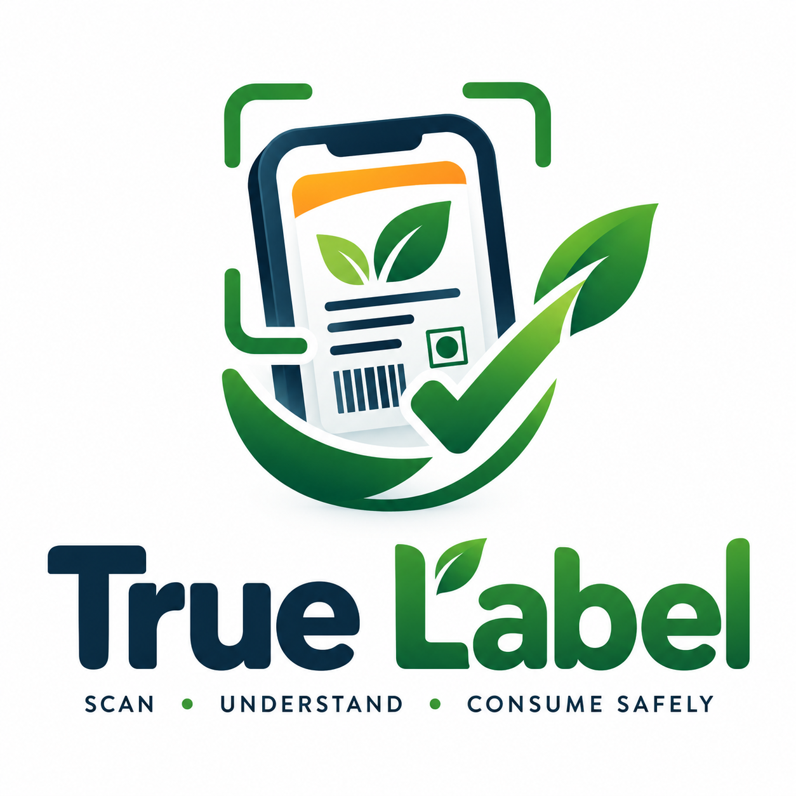
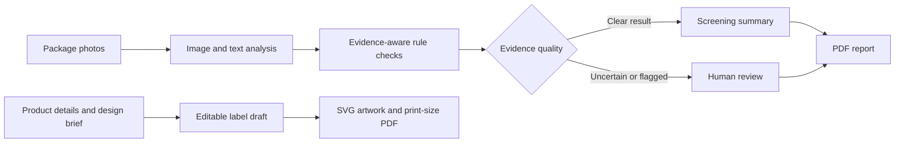
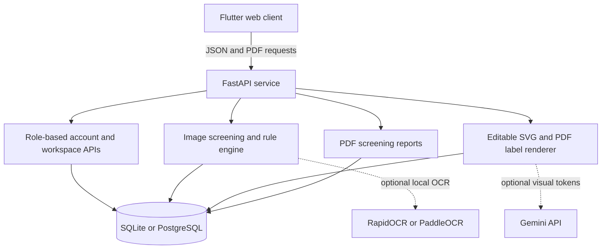

<div align="center">
  

  <h1>True Label</h1>
  <p><strong>Scan. Understand. Consume safely.</strong></p>
  <p>Evidence-led screening and label drafting for packaged products in India.</p>

  <a href="https://web-ten-puce-86.vercel.app/">Open the demo</a> ·
  <a href="https://true-label-backend.onrender.com/docs">Explore the API</a>

  <br /><br />

  
  
  
  
</div>

---

## What it does

True Label turns package photos and product details into reviewable screening results and editable label artwork. It is designed to make label checks easier to understand while keeping the evidence and uncertainty visible.

The application includes three role-based workspaces:

| Workspace | What you can do |
| --- | --- |
| **Business owner** | Register products, review scan history and PDF reports, create editable label drafts, and explore a demo fines and counter-argument flow. |
| **Inspector** | Capture package evidence, review rule-level findings, inspect saved scans, see analysis charts, and raise a case for review. |
| **Administrator** | Browse category-based screening rules, review escalated cases, preview PDF reports and demo notices, and view operational or clearly marked sample analytics. |

### From package photo to review



## Product capabilities

- **Package screening:** submit images of package panels, preserve image evidence with scan records, and inspect extracted declarations and rule checks.
- **Evidence-aware results:** checks distinguish a pass, a potential issue, a confirmed issue and a rule that does not apply. Missing or unreadable evidence is not automatically treated as proof of a violation.
- **Category rule catalogue:** review seeded screening profiles for general packaged goods, food, drinking water, electronics, personal care, medical devices, agricultural inputs and other product groups.
- **Reports:** generate and reopen PDF screening reports from saved scans.
- **Label Draft Studio:** create editable SVG panels and PDFs using supplied product information and physical dimensions. The renderer does not invent missing declarations or recreate brand artwork.
- **Local-first image analysis:** optional RapidOCR or PaddleOCR runtimes process images in the backend environment. The lightweight deployment can return an unresolved result when no OCR runtime is installed; this codebase does not send package photos to an OCR SaaS.
- **Optional AI visual direction:** an explicitly enabled Gemini integration can suggest constrained styling choices. Local code renders the resulting artwork; the model does not author label copy or decide compliance.
- **Demo workflows:** sample analytics, notices, fines, payments and counter-arguments are labelled as illustrative. Demo payment and notice actions do not charge money or send official communications.

## Try the hosted demo

- **Web app:** [web-ten-puce-86.vercel.app](https://web-ten-puce-86.vercel.app/)
- **Backend health:** [true-label-backend.onrender.com](https://true-label-backend.onrender.com/)
- **Interactive API reference:** [OpenAPI docs](https://true-label-backend.onrender.com/docs)

Choose a workspace on the welcome screen to enter its demo flow. The app creates or signs into a role-specific demo account through the API. Demo content is intended for product walkthroughs; persistent scan records depend on the configured backend database.

## Architecture



### Technology

- **Frontend:** Flutter and Dart; `fl_chart` analytics; SVG and PDF preview/export.
- **Backend:** Python, FastAPI, SQLAlchemy and Pydantic.
- **Storage:** SQLite by default or PostgreSQL through `DATABASE_URL`.
- **Image processing:** Pillow and NumPy, with optional RapidOCR or PaddleOCR.
- **Label output:** editable SVG plus dimensioned PDF.

## Run it locally

### 1. Start the backend

From the repository root:

```bash
python -m venv .venv
# Windows PowerShell
.venv\Scripts\Activate.ps1
# macOS / Linux
# source .venv/bin/activate
python -m pip install -r backend/requirements.txt
python -m uvicorn backend.app.main:app --reload
```

The API runs at `http://127.0.0.1:8000`; its interactive reference is at `http://127.0.0.1:8000/docs`. Without `DATABASE_URL`, the application uses SQLite and creates `metrology.db` in its working directory.

To enable local text recognition, install `backend/requirements-ocr.txt`. RapidOCR is detected automatically when available. To prefer PaddleOCR, set `TRUE_LABEL_OCR_ENGINE=paddle`; set `TRUE_LABEL_ENABLE_LOCAL_OCR=0` to disable local OCR. Without an OCR runtime, image evidence is retained and the affected result remains unresolved.

### 2. Start the Flutter app

In a second terminal:

```bash
cd frontend
flutter pub get
flutter run -d chrome
```

The frontend `.env` defaults to `API_BASE_URL=http://127.0.0.1:8000`. Change this value when connecting to another backend. Never put backend secrets in this file: Flutter assets are delivered to the browser.

### Optional visual styling assistant

Set `TRUE_LABEL_GEMINI_API_KEY` in the **backend environment only** to enable the optional Gemini styling assistant. `TRUE_LABEL_GEMINI_MODEL` selects the model and defaults to `gemini-3.5-flash-lite`. The integration sends the category, package shape and dimensions, design brief, and sampled colours when the user enables it. It does not send package photos, OCR text, product name, declaration values or compliance results. Without a key, the local renderer remains available.

## Build for Vercel

From PowerShell in the repository root:

```powershell
.\frontend\build_vercel.ps1
```

The script builds the Flutter web app and places the public Render API origin in the generated web asset. It leaves `frontend/.env` unchanged for local development. Vercel should serve `frontend/build/web` according to the repository's deployment configuration.

For backend hosting, configure `DATABASE_URL` and any optional OCR or Gemini variables in the hosting provider's environment settings. Keep API keys out of Git and out of the Flutter build.

## API areas

| Prefix | Purpose |
| --- | --- |
| `/auth` | Registration, login and account sessions |
| `/scan` | Package image screening and scan evidence |
| `/workspace` | Role-aware products, scans, rules, cases, reports and label drafts |
| `/reports` | Persisted screening report creation and PDF downloads |
| `/label` | Label draft generation and downloads |
| `/health` | Service health check |

## Important boundaries

True Label is a screening and design-support prototype. Its seeded checks are not a complete or legally verified catalogue: applicability can depend on current amendments, product type, exemptions, sale channel, package size and other facts. Automated results are not legal advice, a compliance certificate, an official inspection decision or a government notice. A qualified reviewer should verify the applicable requirements and all final printed copy and artwork.

Image measurements without calibration are indicative only. Review OCR output, declaration values, package panels, SVG layout, print dimensions, artwork, trim and printer settings before relying on a draft. A PDF page keeps its specified physical dimensions; print at actual size / 100% where required.

## Repository map

```text
backend/
  app/api/                 FastAPI routes
  app/db/                  SQLAlchemy models, database and seed catalogue
  app/services/            Screening, OCR and report generation
frontend/
  assets/images/           Brand assets
  assets/maps/             Regional analytics map data
  lib/core/                API client, rule categories and PDF helpers
  lib/features/             Admin, inspector, manufacturer and login screens
  build_vercel.ps1          Production Flutter web build helper
docs/                      Deployment and rule-coverage notes
```

## Further reading

- [Deployment guide](docs/DEPLOYMENT.md)
- [Rule coverage and current limitations](docs/RULE_COVERAGE.md)
- [Legal Metrology and packaged commodities](https://consumeraffairs.gov.in/pages/legal-metrology-act)
- [FSSAI labelling and display regulations](https://fssai.gov.in/food-law/regulations/amendments/labelling-display)
